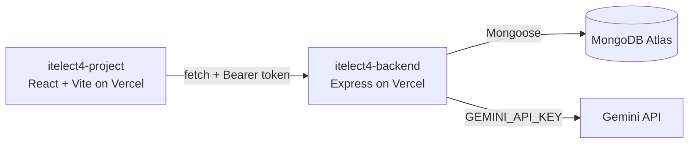

# ITELECT4 Backend

[](https://github.com/leemuelgarcia/itelect4-backend/actions/workflows/ci.yml)

The REST API behind the Peer Tutoring Booking Platform: Express 5 in TypeScript, MongoDB Atlas through Mongoose, JWT login, tutoring sessions and bookings, and one route that asks Google's Gemini model to review a student's learning goal.

## Live deployment

- Live backend API: https://itelect4-backend-sable.vercel.app
- Health check: https://itelect4-backend-sable.vercel.app/api/health
- Live frontend: https://itelect4-project-gamma.vercel.app
- Frontend repository: https://github.com/leemuelgarcia/itelect4-project

## Architecture



## API routes

Public:

- `GET /api/health` - server and database status
- `GET /api/sessions` - list tutoring sessions
- `GET /api/sessions/:id` - one tutoring session, or 404
- `POST /api/auth/register` - create an account (name, email, password, role)
- `POST /api/auth/login` - returns a token and the user

Private (require `Authorization: Bearer <token>`):

- `GET /api/bookings`, `GET /api/bookings/:id`
- `POST /api/bookings`
- `PUT /api/bookings/:id`
- `DELETE /api/bookings/:id`
- `POST /api/ai` - Gemini reviews a learning goal and answers with a summary, topics, preparation steps and a clarity rating. Five requests a minute per account.

## Environment variables

Copy `.env.example` to `.env` and fill it in. `.env` is never committed.

- `MONGODB_URI` - MongoDB Atlas connection string
- `JWT_SECRET` - secret used to sign login tokens
- `CORS_ORIGIN` - allowed frontend origin(s), comma separated. Locally `http://localhost:5173`; on Vercel the deployed frontend address.
- `GEMINI_API_KEY` - Google Gemini key from aistudio.google.com. Server-side only: it is never sent to the browser and never committed. Set it in `.env` and in the Vercel project.
- `PORT` - local development port only (use `5001`). Not set on Vercel.

## Run locally

```bash
npm install
cp .env.example .env
npm run dev
```

Seed the tutoring sessions (safe to run more than once, it updates by id):

```bash
npx tsx src/seedSessions.ts
```

Try the AI review from the terminal (one real request to Gemini, no server needed):

```bash
npm run try-ai
```

Type-check and build:

```bash
npm run build
```

## Run the tests

```bash
npm test
npm run typecheck
```

`tests/ai.test.ts` uses Vitest and Supertest to send real requests to the real Express app, with the database connection replaced and Gemini never called. It checks that `POST /api/ai` answers 401 with no token, 401 with a forged token, and, with a valid token, gets past the login check and is refused by the request schema. GitHub Actions (`.github/workflows/ci.yml`) runs the type check and these tests on every push, with `JWT_SECRET` stored as a repository secret.

## Deployment

Deployed on Vercel. `src/server.ts` default-exports the Express app, the database connects in middleware, and `src/local.ts` starts the local server. Atlas network access allows `0.0.0.0/0`. After the frontend was deployed, `CORS_ORIGIN` was set to the frontend address and the backend was redeployed.

## AI-use disclosure

I used an AI assistant (Claude, by Anthropic) while building this project. It helped write and explain code, tests, the CI workflow and this README across the GT4 to GT6 work. I ran, tested and deployed everything myself. The deployed app also calls Google's Gemini model (`gemini-flash-lite-latest`) at runtime, through `POST /api/ai`.
